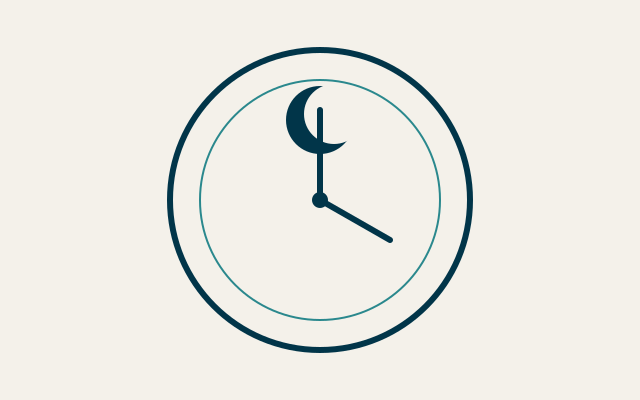
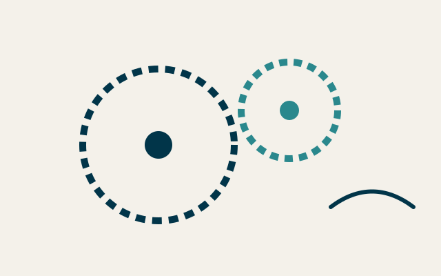

+++
title = 'The workshop’s astronomical clock'
slug = 'astronomical-clock'
description = 'A wall clock showing the phases of the moon, the equation of time and sunrise at the workshop’s latitude.'

[params]
  kind = 'engagement'
  client = 'Museum of the Arts of Time'
  agency = 'Balancier & Partners'
  clientLogo = 'logo-musee.svg'
  agencyLogo = 'logo-balancier.svg'
  role = 'Lead clockmaker'
  years = '2016 – 2018'
  format = 'One-off piece'
  mode = 'Time and materials'
  duration = '26 months'
  stack = ['Brass', 'Steel', 'Glass']
+++

## The need

The museum wanted a clock that tells the sky above the workshop, readable by a hurried visitor as well as by an astronomer.

## The mechanism

A dedicated gear train corrects, every day, the gap between solar time and mean time.

- A hardened steel cam for the equation of time
- A 59-tooth wheel for the lunar month
- An engraved glass disc for sunrise

