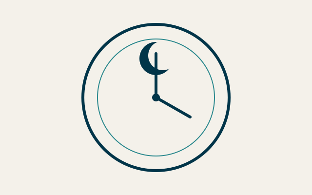
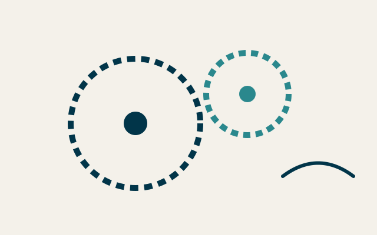

+++
title = 'Horloge astronomique de l’atelier'
description = 'Horloge murale qui affiche les phases de la lune, l’équation du temps et le lever du soleil à la latitude de l’atelier.'

[params]
  kind = 'engagement'
  client = 'Musée des Arts du Temps'
  agency = 'Balancier & Associés'
  clientLogo = 'logo-musee.svg'
  agencyLogo = 'logo-balancier.svg'
  role = 'Horloger principal'
  years = '2016 – 2018'
  format = 'Pièce unique'
  mode = 'Régie'
  duration = '26 mois'
  stack = ['Laiton', 'Acier', 'Verre']
+++

## Le besoin

Le musée voulait une horloge qui raconte le ciel de l’atelier, lisible par un visiteur pressé comme par un astronome.

## Le mécanisme

Un train d’engrenages dédié corrige chaque jour l’écart entre le temps solaire et le temps moyen.

- Une came en acier trempé pour l’équation du temps
- Un rouage de 59 dents pour la lunaison
- Un disque de verre gravé pour le lever du soleil

